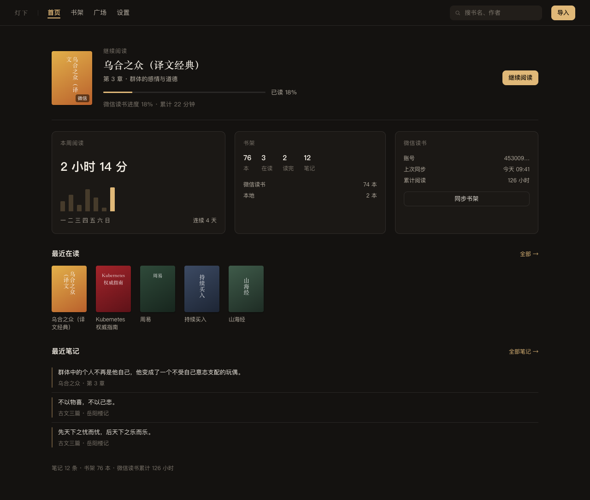
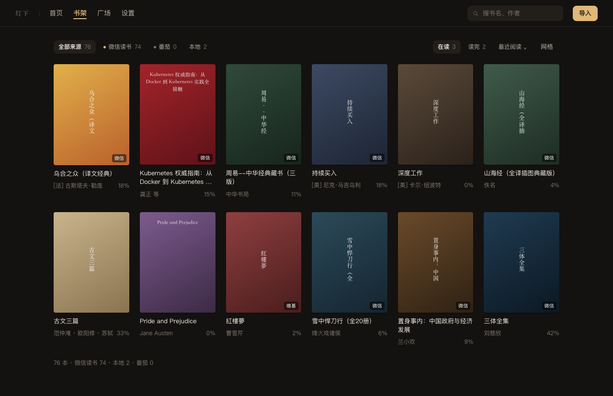
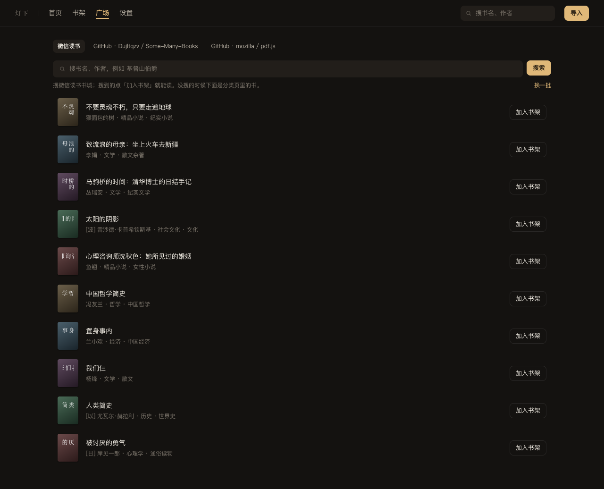
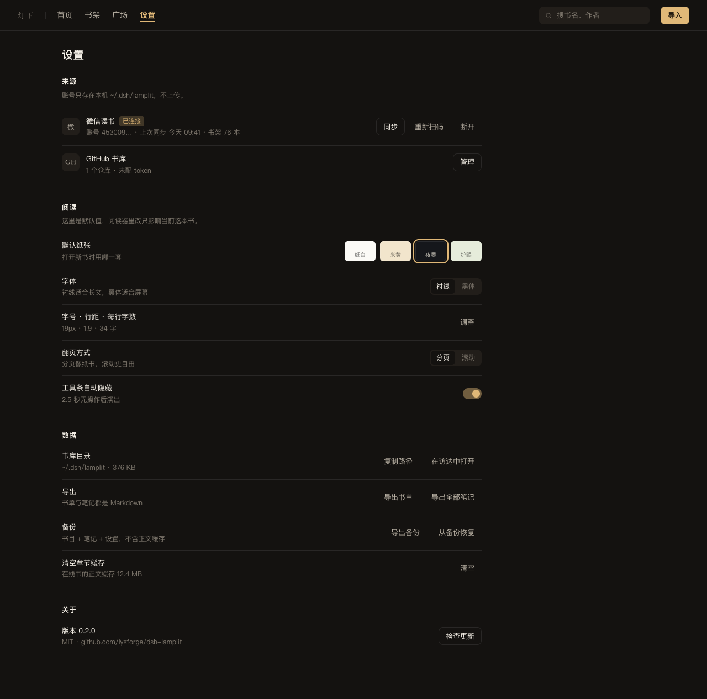
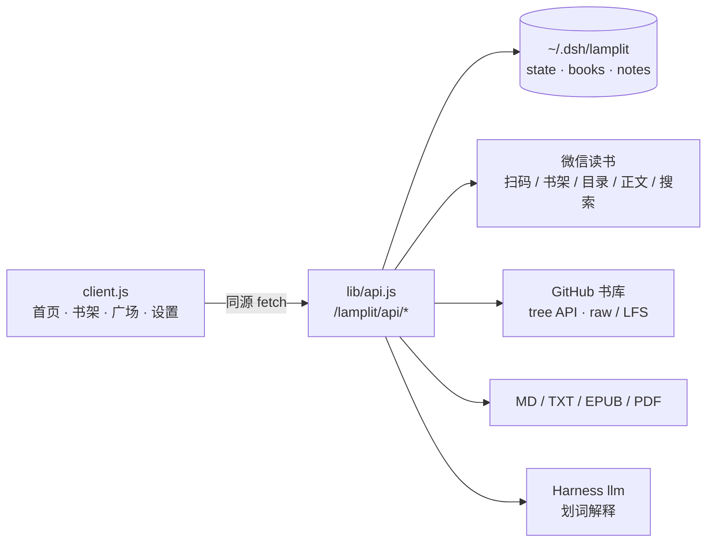

# 灯下 · Lamplit


**One quiet shelf for WeChat Reading, GitHub book repos and your own files — inside [DeepSeek Harness](https://github.com/deepseek-ai).**

[](https://www.npmjs.com/package/dsh-lamplit)
[](https://github.com/lysforge/dsh-lamplit/actions/workflows/test.yml)
[](LICENSE)


灯下是 DeepSeek Harness 的一个读书插件：**一个书架 + 一个沉浸式阅读器**，把你散在三处的阅读收进同一盏灯下。

- **微信读书** —— 扫码登录你自己的账号，书架、目录、正文、书城搜索都在插件里，不跳浏览器
- **GitHub 书库** —— 填一个 `owner/repo`，把它里面的 PDF / EPUB / TXT 当书架用
- **自己的文件** —— Markdown / TXT / EPUB / PDF 直接导入；扫描版 PDF 走页面渲染，不硬抽文字

> 名字取自「灯下夜读」。不推送、不社交、不做阅读排行，只负责让一本书在你面前摊开。

## 四个页面

<!-- 以下为设计稿（design/*.png），按最终实现绘制 -->

**首页** — 继续阅读、本周阅读、书架概览、微信读书状态、最近在读、最近笔记



**书架** — 来源筛选 + 在读/读完 + 排序 + 密度，封面网格 6/4/3/2 列自适应



**广场** — 左边书源（微信读书 / 你的 GitHub 仓库），微信读书 tab 直接搜书城，GitHub tab 列仓库文���（每页 10 个）



**设置** — 来源（微信读书、GitHub 书库）、阅读默认值、数据（导出/备份/缓存）、关于



## Why another reader

Harness 里已经有聊天、终端、文件系统。读书缺的从来不是「再一个阅读器」，而是这三件事：

1. **书不在一处**：微信读书一个 App、下载的 PDF 一个文件夹、GitHub 上的资料又是一个仓库。
2. **进度记不住**：本地阅读器关掉，下次还得自己找位置。
3. **想留住一句话**：划线要另开笔记软件。

灯下把这三件事塞进一个面板：统一书架、按章记进度（还会读你微信读书那边的云端进度）、选中就能问 AI 并存成笔记。

## 功能

| | |
|---|---|
| 📚 **一个书架** | 微信读书 / 本地文件 / GitHub 下载混排，封面网格 + 继续阅读，来源筛选与排序 |
| 🔐 **用你自己的账号** | 微信读书扫码即登，Cookie 只落本机；GitHub 可用 token 提高限额 |
| 🏪 **广场** | 微信读书书城**真搜索**（搜「基督山伯爵」出 51 条）+ 分类书目；GitHub 仓库按页浏览 |
| 📖 **沉浸阅读** | 四套纸张（纸白 / 米黄 / 夜墨 / 护眼）、衬线限宽、分页与滚动、目录抽屉、工具条自动淡出、键盘翻页 |
| 🖍 **划词 AI** | 选中一段 → 解释 / 补充 / 记笔记 / 复制，走 Harness 当前默认模型 |
| 🗂 **笔记** | 按书分组、跳回正文那一句、导出 Markdown（本书 / 全部） |
| 📄 **导入** | Markdown、TXT、EPUB（自研 ZIP + OPF/spine）、PDF（文字层则排版，扫描件则页面渲染） |
| 📊 **统计** | 今日 / 本周 / 总计 / 连续天数 / 读完，7 天柱状图，数据只在本机 |
| ⚡ **不重复拉取** | 分类书目 30 分钟缓存、仓库目录 5 分钟缓存、前端会话缓存，切页签不再重拉 |
| 🎯 **零依赖** | Host 与 Client 都是纯 JS：PDF 抽取、EPUB 解析、二维码渲染全部自己实现 |

## 支持矩阵（实话实说）

| 能力 | 状态 | 说明 |
|---|---|---|
| 微信读书 · 书架/目录/正文 | ✅ | 扫码后自动同步书架；打开书时按需拉目录，正文懒加载并缓存 |
| 微信读书 · 云端进度/时长 | 只读 | 能读到你账号的进度与累计时长，但**不回写**（不伪造阅读时长） |
| 微信读书 · 书城搜索 | ✅ | 搜索页在**不带 Cookie** 时才是服务端渲染的完整结果（带 Cookie 会返回空壳） |
| GitHub 书库 | ✅ | 列 PDF/EPUB/TXT/MD，支持 `owner/repo#子目录`、Git LFS、可选 token；单文件上限 120MB |
| 本地 Markdown / TXT | ✅ | 按标题 / 「第 X 章」切章 |
| EPUB | ✅ | 自研 ZIP + OPF spine + XHTML → 块，目录取 nav/ncx |
| PDF · 有文字层 | ✅ | 零依赖抽取（Flate + Tj/TJ + ToUnicode CMap），可划词 |
| PDF · 扫描/影印 | ✅ 页面渲染 | 标记为「影印」，用浏览器内置 PDF 渲染器显示原页面，不能划词 |
| 番茄小说 | ❌ 已下线 | 无公开书城、搜索带滑块验证、正文有字体反爬，0.2.0 起移除 |
| MOBI / AZW3 / KFX | ❌ | 亚马逊私有容器，先用 Calibre 转 EPUB |

## 安装

**在 Harness 里装（推荐）**

```
插件（Plugins）→ 安装 → 输入 dsh-lamplit
```

或者命令行（npm 上是 `dsh-lamplit`，带 SLSA provenance）：

```bash
dsh plugin --profile <profile> add dsh-lamplit
```

**装不上 npm 时用 Release 附件**

```bash
dsh plugin --profile <profile> add https://github.com/lysforge/dsh-lamplit/releases/download/v0.1.3/dsh-lamplit-0.1.3.tgz
```

**从源码装**（开发用）

```bash
git clone https://github.com/lysforge/dsh-lamplit.git
cd lamplit
node --test test/*.test.mjs      # 32 项
```

然后在插件页用「从本地目录安装」选中这个目录。

## 第一次用

1. 点左侧「灯下」→ 顶栏 **导入**，把 `.md / .txt / .epub / .pdf` 拖进书架。
2. 想读微信读书：**设置 → 来源 → 微信读书 → 用微信扫码登录**，扫完自动同步书架。
3. 想找免费书：**广场 → 微信读书**搜书名，或 **设置 → GitHub 书库 → 管理**里加一个仓库，回广场按页浏览、点「下载」。
4. 点开任意一本开始读。选中正文任一段，浮出工具条：解释 / 补充 / 记笔记 / 复制。

## 数据与隐私

- 所有数据在 `~/.dsh/lamplit/`：`state.json`（设置 + 书目 + 凭据）、`books/<id>.json`（正文）、`notes.json`、`files/`（影印 PDF 原件）。
- 权限 `0600`，Cookie 与 GitHub token **不会**回显到界面，也不会离开本机。
- 没有遥测、没有账号体系、不上传任何内容。插件只在你的明确操作下访问 `weread.qq.com`、`github.com` / `raw.githubusercontent.com`。

## 结构



| 文件 | 作用 |
|---|---|
| `index.js` | Host 入口：把 `/lamplit/*` 挂到宿主 webServer（handler 路由，支持 POST/DELETE） |
| `lib/api.js` | 全部接口：state / import / book / chapter / progress / notes / ai / provider / github |
| `lib/store.js` | 原子写、`0600`、批量入库、按日统计、GitHub 配置 |
| `lib/markdown.js` `lib/txt.js` `lib/epub.js` `lib/pdf.js` `lib/pdf-text.js` | 四种格式解析；PDF 抽取零依赖 |
| `lib/providers/weread.js` | 微信读书适配器（含书城搜索、分类书目） |
| `lib/sources/github.js` | GitHub 仓库：目录树、子目录、LFS、下载 |
| `lib/ai.js` | 划词 AI，复用宿主 `llm` 服务 |
| `client.js` | 全部界面（React 无 JSX、样式 `<style>` 注入、只用宿主 token） |

## 开发

```bash
node --test test/*.test.mjs     # 32 项：解析器 / 路由 / 导出 / GitHub / client 静态契约

# 视觉层：把 client.js 真挂到 jsdom 上，点遍每个 tab，抓渲染期异常
npm i --no-save --no-package-lock jsdom react@18 react-dom@18
node tools/render-check.mjs
```

- Host 侧不依赖任何第三方包；PDF / EPUB / ZIP 都是自己解的。
- Client 侧只 `require('react')`，没有构建步骤。
- 改动后 ⌘R 刷新即可看到新界面。

发版（Trusted Publishing，无需 token）：

```bash
# 改 package.json 版本 → 提交
git tag v0.2.0 && git push --tags
```

`.github/workflows/publish.yml` 会用 OIDC 发布并附 provenance。

## 已知边界

- 扫描版 PDF 可读但**不能划词**（浏览器内置 PDF 查看器里拿不到选区）。
- 微信读书 Cookie 约一个月过期，过期后重新扫码。
- GitHub 未登录 60 次/小时，填 token 提到 5000；GitHub 单文件上限 120MB。
- GitHub 仓库的内容与授权由填写者负责，插件只做通路。

## 致谢

微信读书网页版的签名与分片解码来自 [dsh-weread](https://github.com/wwjzzy/dsh-weread)（MIT），见 [NOTICE.md](NOTICE.md)。其余代码与界面为本项目原创。

## License

MIT © lysforge

---

## English

**Lamplit** is a reading plugin for DeepSeek Harness: one shelf for WeChat Reading, GitHub book repos and your own Markdown / TXT / EPUB / PDF files, with an immersive reader and AI-on-selection notes.

- **Four pages** — Home (continue reading, weekly stats, recent), Shelf (cover grid), Plaza (WeRead store search + your GitHub repos), Settings.
- **WeChat Reading** — scan the official QR once; shelf, chapters, cloud progress and store search work inside Harness. Your cookie stays local.
- **GitHub library** — point at `owner/repo` (optionally `#subfolder`) and browse/download its PDF, EPUB and TXT files, 10 per page, with Git LFS support.
- **Your files** — Markdown, TXT, EPUB, PDF. Text PDFs are reflowed; scanned PDFs are rendered as pages, not force-extracted.
- **Selection AI** — select a passage, ask for an explanation or background, save it as a note; export notes as Markdown.
- **Local first** — everything lives in `~/.dsh/lamplit` with `0600`, no telemetry, no upload.

```bash
dsh plugin --profile <profile> add dsh-lamplit
```

MIT licensed. Built in the open at [lysforge/dsh-lamplit](https://github.com/lysforge/dsh-lamplit).
