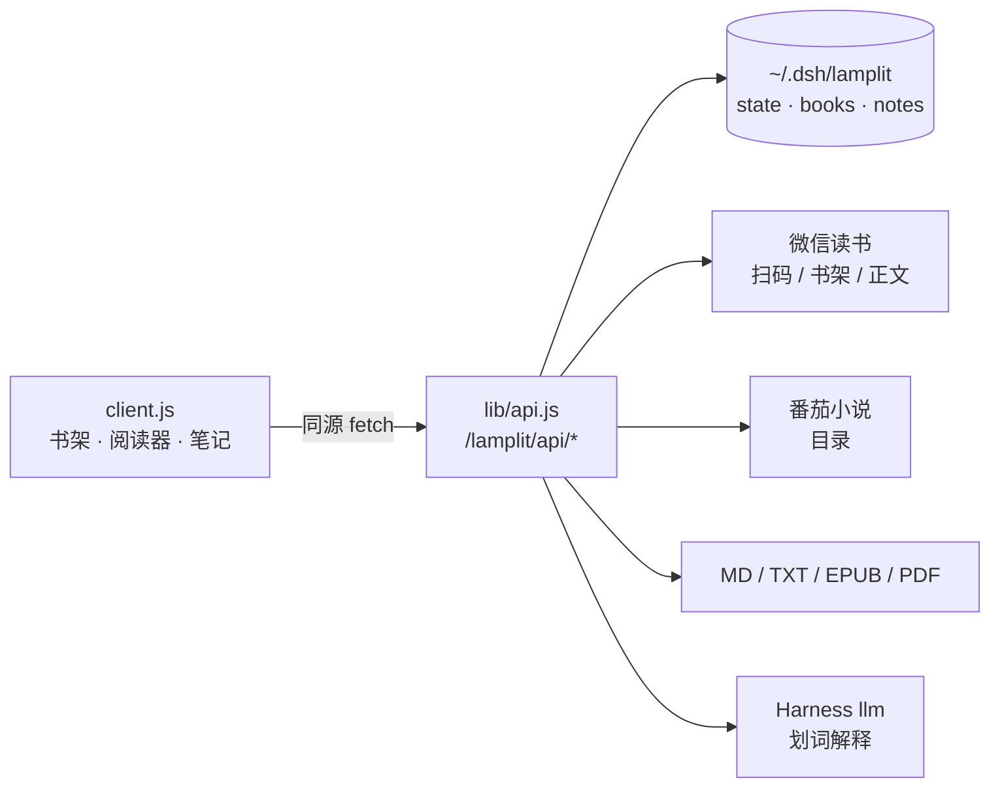

# 灯下 · Lamplit


**One quiet shelf for WeChat Reading, Fanqie Novel and your own books — inside [DeepSeek Harness](https://github.com/deepseek-ai).**

[](https://www.npmjs.com/package/dsh-lamplit)
[](https://github.com/lysforge/lamplit/actions/workflows/test.yml)
[](LICENSE)


灯下是 DeepSeek Harness 的一个读书插件：一个书架、一个沉浸式阅读器，把你散在三个地方的阅读收进同一盏灯下。

- **微信读书** —— 扫码登录你自己的账号，书架、目录、正文都在插件里读，不用跳浏览器
- **番茄小说** —— 粘一条链接就加书，目录同步；正文受平台字体加密限制，会直说，不灌乱码
- **自己的文件** —— Markdown / TXT / EPUB / PDF 直接导入；扫描版 PDF 走页面渲染，不硬抽文字

> 名字取自「灯下夜读」。这个插件不推送、不社交、不做阅读时长排行，只负责让一本书在你面前摊开。

---

## Why another reader

Harness 里已经有聊天、有终端、有文件系统。读书这事缺的从来不是「再一个阅读器」，而是这三件事：

1. **你的书不在一处**：微信读书一个 App、番茄一个、下载的 PDF 一个文件夹。
2. **进度记不住**：本地阅读器读完关掉，下次还得自己找位置。
3. **想留住一句话**：划线要另开笔记软件，读完就散了。

灯下把这三件事塞进一个面板：统一书架、按章记进度、选中就能问 AI 并存成笔记。

## Features

| | |
|---|---|
| 📚 **一个书架** | 微信读书 / 番茄 / 本地文件混排，封面网格 + 继续阅读条，来源筛选与排序 |
| 🔐 **用你自己的账号** | 微信读书扫码即登（Cookie 只落本机），番茄免登录加书 |
| 📖 **沉浸阅读** | 四套纸张主题（纸白 / 米黄 / 夜墨 / 护眼）、衬线限宽、分页与滚动双模式、目录抽屉、工具条自动淡出、键盘翻页 |
| 🖍 **划词 AI** | 选中一段 → 解释 / 补充 / 记笔记 / 复制，走 Harness 当前默认模型，结果可存为笔记 |
| 🗂 **笔记** | 按书分组，点引文跳回正文那一句，可导出 Markdown（本书 / 全部） |
| 📄 **导入** | Markdown（按标题切章）、TXT（按「第 X 章」切章）、EPUB（自研 ZIP + OPF/spine）、PDF（有文字层则排版，扫描件则页面渲染） |
| 📊 **统计** | 今日 / 本周 / 总计 / 连续天数 / 读完本数，7 天柱状图，数据只在本机 |
| 🎯 **零依赖** | Host 与 Client 都是纯 JS；PDF 抽取、EPUB 解析、二维码渲染全部自己实现 |

## 支持矩阵（实话实说）

| 能力 | 状态 | 说明 |
|---|---|---|
| 微信读书 · 书架/目录/正文 | ✅ | 扫码后自动同步书架；打开书时按需拉目录，章节正文懒加载并缓存 |
| 微信读书 · 站内找书 | ✅ | 已登录时可在来源面板搜索并加入书架 |
| 微信读书 · 云端进度 | 只读 | 能读到你账号的进度，但**不回写**（不伪造阅读时长） |
| 番茄小说 · 目录/书名/封面 | ✅ | 粘 `fanqienovel.com/page/<id>` 即可 |
| 番茄小说 · 正文 | ⚠️ 多数不可读 | 免费正文被平台换成私用区字形（字体反爬）。抓到混淆文本时接口返回 `code: OBFUSCATED`，界面引导去官方 App 读或用「粘贴正文」导入 |
| 番茄小说 · 搜索 | ❌ | 接口带滑块验证，插件不绕它 |
| MOBI / AZW3 / KFX | ❌ | 亚马逊私有容器（KFX 带 DRM），先用 Calibre 转 EPUB |

## Install

**在 Harness 里装（推荐）**

```
插件（Plugins）→ 安装 → 输入 dsh-lamplit
```

或者命令行（npm 上是 `dsh-lamplit@0.1.1`，带 SLSA provenance）：

```bash
dsh plugin --profile desktop add dsh-lamplit
```

**装不上 npm 时用 Release 附件**

```bash
dsh plugin --profile <profile> add https://github.com/lysforge/lamplit/releases/download/v0.1.1/dsh-lamplit-0.1.1.tgz
```

**从源码装**

```bash
git clone https://github.com/lysforge/lamplit.git
cd lamplit && node --test test/*.test.mjs     # 24 项通过再装
```

然后在 Harness 的插件页用「从本地目录安装」选中这个目录。装完 ⌘R 刷新，左侧图标栏多一盏灯。

## 第一次用

1. 点左侧「灯下」→ 顶栏 **导入**，把 `.md / .txt / .epub / .pdf` 拖进书架。
2. 想在灯下里读微信读书：顶栏 **来源** → 微信读书 → **用微信扫码登录**，扫完自动同步书架。
3. 点开任意一本开始读。选中正文任一段，浮出工具条：解释 / 补充 / 记笔记 / 复制。

## 数据与隐私

- 所有数据在 `~/.dsh/lamplit/`：`state.json`（设置 + 书目 + 凭据）、`books/<id>.json`（正文）、`notes.json`、`files/`（影印 PDF 原件）。
- 文件权限 `0600`，Cookie **不会**回显到界面，也不会离开本机。
- 没有遥测、没有账号体系、不上传任何内容。插件只在你的明确操作下访问 `weread.qq.com` / `fanqienovel.com`。

## 结构



| 文件 | 作用 |
|---|---|
| `index.js` | Host 入口：把 `/lamplit/*` 挂到宿主 webServer（handler 路由，支持 POST/DELETE） |
| `lib/api.js` | 全部接口：state / import / book / chapter / progress / notes / ai / provider |
| `lib/store.js` | 原子写、`0600`、批量入库、按日统计 |
| `lib/markdown.js` `lib/txt.js` `lib/epub.js` `lib/pdf.js` `lib/pdf-text.js` | 四种格式的解析；PDF 抽取零依赖（Flate + ToUnicode CMap） |
| `lib/providers/*.js` | 两个来源的适配器 |
| `lib/ai.js` | 划词 AI，复用宿主 `llm` 服务 |
| `client.js` | 全部界面（React 无 JSX、样式 `<style>` 注入、只用宿主 token） |

## 开发

```bash
node --test test/*.test.mjs        # 24 项：解析器 + 路由 + 导出 + 影印文件
```

- Host 侧不依赖任何第三方包；PDF / EPUB / ZIP 都是自己解的。
- Client 侧只 `require('react')`，没有构建步骤。
- 改动后 ⌘R 刷新页面即可看到新界面。

## 已知边界

- 扫描版 PDF 可读但**不能划词**（浏览器内置 PDF 查看器里拿不到选区）。
- 加密 PDF 不处理。
- 微信读书付费章节按你账号的权限返回。
- 微信读书 Cookie 约一个月过期，过期后重新扫码即可。

## 致谢

微信读书网页版的签名与分片解码来自 [dsh-weread](https://github.com/wwjzzy/dsh-weread)（MIT），见 [NOTICE.md](NOTICE.md)。其余代码与界面为本项目原创。

## License

MIT © lysforge

---

## English

**Lamplit** is a reading plugin for DeepSeek Harness: one shelf for WeChat Reading (微信读书), Fanqie Novel (番茄小说) and your own Markdown / TXT / EPUB / PDF files, with an immersive reader and AI-on-selection notes.

- **WeChat Reading** — scan the official QR once, then browse and read your own shelf inside Harness. Your cookie stays local.
- **Fanqie Novel** — paste a book link; the table of contents syncs. The free text is font-obfuscated by the platform, so Lamplit says so instead of showing garbage.
- **Your files** — Markdown, TXT, EPUB, PDF. Text PDFs are reflowed; scanned PDFs are rendered as pages (like Preview or Kindle), not force-extracted.
- **Selection AI** — select a passage, ask for an explanation or background, save it as a note; export notes as Markdown.
- **Local first** — everything lives in `~/.dsh/lamplit` with `0600`, no telemetry, no upload.

Install:

```bash
dsh plugin --profile desktop add dsh-lamplit
```

MIT licensed. Built in the open at [lysforge/lamplit](https://github.com/lysforge/lamplit).
